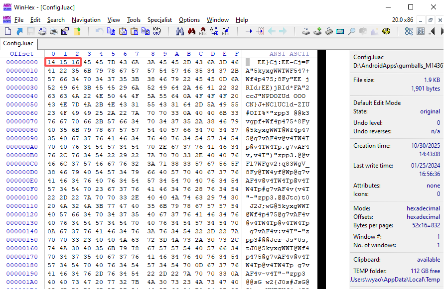
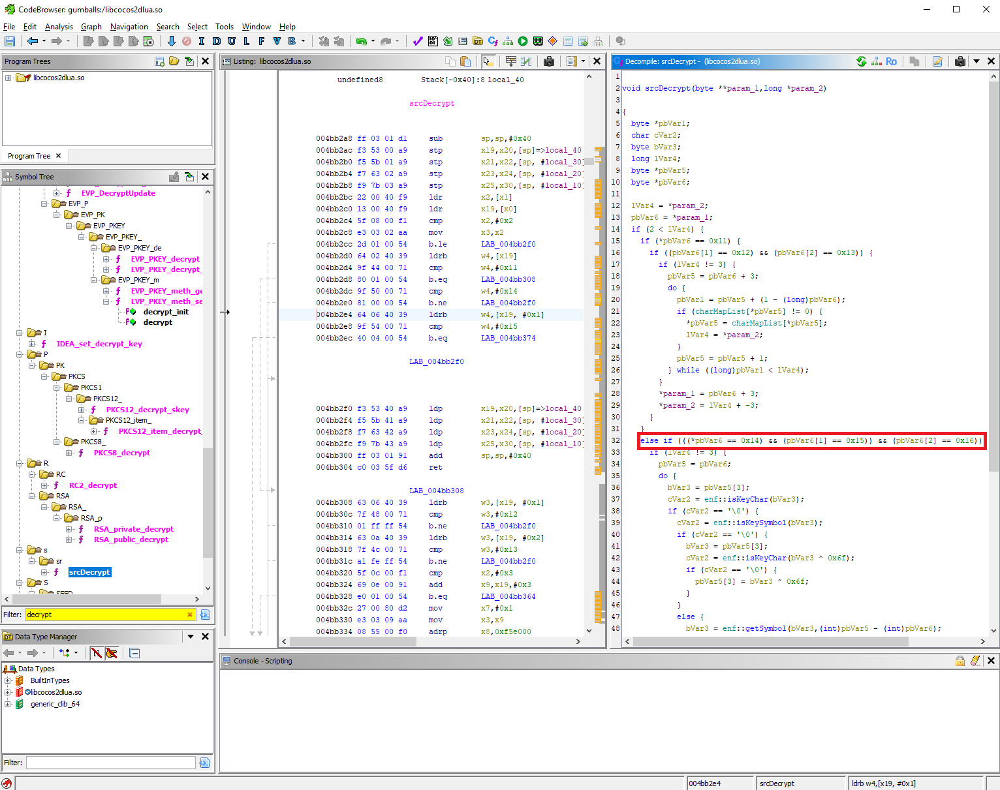
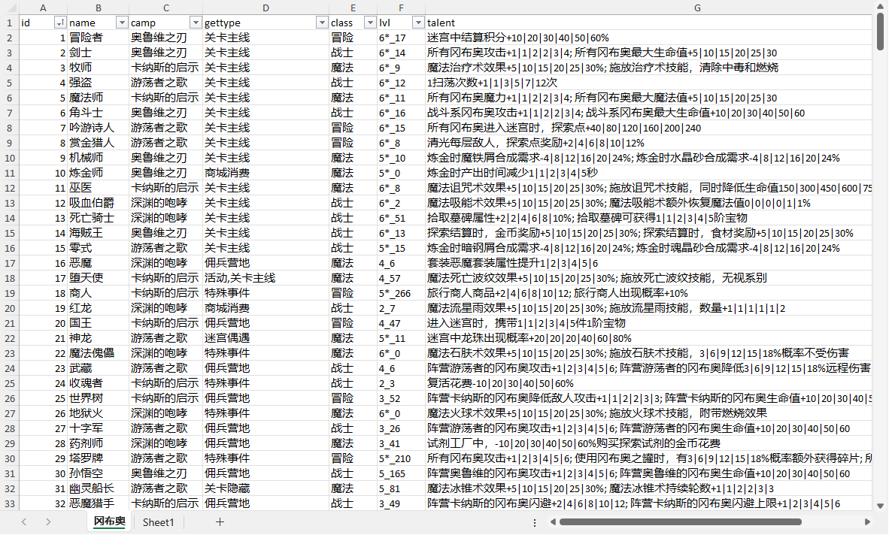

不思议迷宫
===========================

000
---------------------------

不思议迷宫是一款蛮老的游戏了，我断断续续玩了很久。这真是一款很好玩的游戏，一款纯粹的游戏（这是我对游戏的最高评价）

但是随着游戏要素越来越多，信息过于庞大，游戏过于复杂，网上信息又零零碎碎。于是我决定来研究一下，看看能不能整理出一些和游戏相关的资料

001
---------------------------
首先游戏解压缩以后，我看见游戏是用cocos2 + lua脚本写的。在assets\src目录下有大量的.luac文件。但是文件显然加密了。



种种迹象表明，这里应该用的是类似凯撒密钥的加密机制，而不是带CBC的现代加密算法。于是我逆向了 lib\arm64-v8a\libcocos2dlua.so 这个文件，试图弄明白lua源代码加密的原理。顺便说一句，我最近已经不再使用IDA pro了，Ghidra的功能也一样强大一样好用，这里给做个广告，强烈推荐。

Ghidra打开并分析这个文件后，我搜索了一下symbol表，发现一个叫srcDecrypt的函数非常可疑。反编译后可以看到这里判断了数组的前三个字节是否为0x14,0x15,0x16。我知道这就是我要找函数了！因为那些luac文件的前三个自己就是0x14,0x15,0x16



这段代码很短，很容易读。大致就是对于[0-9a-zA-Z]和[{}().: _,\n\r=-;%|*+#]以及其它字符使用了不同的加密方法。

```C
    if (((*pbVar6 == 0x14) && (pbVar6[1] == 0x15)) && (pbVar6[2] == 0x16)) {
      if (lVar4 != 3) {
        pbVar5 = pbVar6;
        do {
          bVar3 = pbVar5[3];
          cVar2 = enf::isKeyChar(bVar3);
          if (cVar2 == '\0') {
            cVar2 = enf::isKeySymbol(bVar3);
            if (cVar2 == '\0') {
              bVar3 = pbVar5[3];
              cVar2 = enf::isKeyChar(bVar3 ^ 0x6f);
              if (cVar2 == '\0') {
                pbVar5[3] = bVar3 ^ 0x6f;
              }
            }
            else {
              bVar3 = enf::getSymbol(bVar3,(int)pbVar5 - (int)pbVar6);
              pbVar5[3] = bVar3;
            }
          }
          else {
            bVar3 = enf::getChar(bVar3);
            pbVar5[3] = bVar3;
          }
          lVar4 = *param_2;
          pbVar1 = pbVar5 + (4 - (long)pbVar6);
          pbVar5 = pbVar5 + 1;
        } while ((long)pbVar1 < lVar4);
      }
      *param_1 = pbVar6 + 3;
      *param_2 = lVar4 + -3;
    }

```

但是继续看getSymbol和getChar, 我震惊了。这里面竟然牵涉到好几个巨大的数组和上千个函数

* enf::f_0 ~ enf::f_5000 共5001个函数，每个函数硬编码返回一个ui8
* ui8 (*funcs[4920])(), 在enf::init()中初始化, 指向了enf::f_0 ~ enf::f_4919
* ui8 (*charFuncArr[62])(), 在enf::initCharMap()中初始化，指向了enf::f_4920 ~ enf::f_4981
* ui8 (*symbolFuncs[19])(), 在enf::initSymbolMap()中初始化, 指向了enf::f_4982 ~ enf::f_5000
* ui8 symbolIndexArr[256], 在enf::initSymbolMap()中初始化, 为19个symbol char初始化成0~18

所以关键在于弄明白enf::f_0 ~ enf::f_5000 这5001个函数到底干了些什么？我大致看了一下，基本上每一个函数都是硬编码返回一个ui8的数字，但是函数的实现并不完全一样，有以下几种可能的pattern

```assembly
00000000003bc264 <enf::f_0>:
  3bc264:	52800080 	mov	w0, #0x4
  3bc268:	d65f03c0 	ret

00000000003c44a0 <enf::f_4146>:
  3c44a0:	d0003d20 	adrp	x0, b6a000
  3c44a4:	91334000 	add	x0, x0, #0xcd0
  3c44a8:	b9402c00 	ldr	w0, [x0, #44]
  3c44ac:	d65f03c0 	ret

00000000003bc63c <enf::f_123>:
  3bc63c:	528002c0 	mov	w0, #0x16
  3bc640:	6b00001f 	cmp	w0, w0
  3bc644:	52800600 	mov	w0, #0x30
  3bc648:	1a9f0000 	csel	w0, w0, wzr, eq
  3bc64c:	d65f03c0 	ret

00000000003c2420 <enf::f_3109>:
  3c2420:	52801580 	mov	w0, #0xac
  3c2424:	6b00001f 	cmp	w0, w0
  3c2428:	54000080 	b.eq	3c2438
  3c242c:	71016c1f 	cmp	w0, #0x5b
  3c2430:	1a9f0000 	csel	w0, w0, wzr, eq
  3c2434:	d65f03c0 	ret
  3c2438:	52800c80 	mov	w0, #0x64
  3c243c:	d65f03c0 	ret

00000000003c0d10 <enf::f_2379>:
  3c0d10:	52800840 	mov	w0, #0x42
  3c0d14:	6b00001f 	cmp	w0, w0
  3c0d18:	540000a0 	b.eq	3c0d2c
  3c0d1c:	71000c1f 	cmp	w0, #0x3
  3c0d20:	52800ac0 	mov	w0, #0x56
  3c0d24:	1a9f0000 	csel	w0, w0, wzr, eq
  3c0d28:	d65f03c0 	ret
  3c0d2c:	52800620 	mov	w0, #0x31
  3c0d30:	d65f03c0 	ret

```

写了一小段代码，用capstone来反汇编这些函数，然后求出每一个函数到底硬编码了什么数字。

```python
from capstone import *
from capstone.arm64 import *
md = Cs(CS_ARCH_ARM64, CS_MODE_ARM)
md.detail = True
buf =  open("libcocos2dlua.so", "rb").read()

def disfunc(code, offset):
    i = list(md.disasm(code, offset))
    if len(i)==2:
        return i[0].operands[1].value.imm
    elif len(i)==4:
        return 0x7b
    elif len(i)==5:
        return i[2].operands[1].value.imm
    elif len(i)== 8:
        return i[6].operands[1].value.imm
    elif len(i)== 9:
        return i[7].operands[1].value.imm
    else:
        print("%x"%(offset), code)

# aarch64-linux-gnu-objdump -CTt libcocos2dlua.so | sort > syms.txt
# copy lines enf::f_0 to enf::f_5000 to symsf.txt
lines = open("symsf.txt").readlines()
symbols = [(int(l[0:16],16), int(l[31:47],16), l[61:].strip()) for l in lines]
res = [disfunc(buf[off:off+size], off) for off, size, funcname in symbols]
for off, size, funcname in symbols:
    print(funcname, disfunc(buf[off:off+size], off))
```

最后凑齐了解密源代码所需要的所有的数据。这些数据可以被看作一组密钥，下面这段代码利用这些密钥可以正确的解密那些luac文件。这篇文章只讲原理，所以这里密钥被我隐去了。

```python

from base64 import b64decode
funcs = b"************************"
symbolFuncs = b"***************************"
symbolIndexArr={}
charFuncArr={}

def srcDecrypt(filename):
    src = open(filename, "rb").read()[3:]
    out = []
    for i, c in enumerate(src):
        if 0x30 <= c <= 0x39 or 0x41 <= c <= 0x5a or 0x61 <= c <= 0x7a:
            out.append(charFuncArr[c])
        elif c in symbolIndexArr:
            out.append(symbolFuncs[(symbolIndexArr[c]+funcs[i%4920])%19])
        else:
            d = c^0x6f
            if 0x30 <= d <= 0x39 or 0x41 <= d <= 0x5a or 0x61 <= d <= 0x7a:
                out.append(c)
            else:
                out.append(d)
    return bytes(out)
```

002
---------------------------
将所有的lua文件解密后，可以看到在assets/src/game/csv下有大量的表格数据。比如说pet.csv里列出了所有的冈布奥。这正是我要找的数据。但是这些是lua语法的，并不是json之类的通用数据格式。我对lua不是很熟悉，要正确的解析这些文件还要花点功夫。

另外在assets/src/game/loc下是中文和英语的本地化文件，里面包含了游戏中所需要的所有文字。

下面这段代码是用来读取loc文件的

``` python
    def buildloc(self):
        if os.path.exists(self.root+"/src/game/loc/locale.json"):
            locs = json.load(open(self.root+"/src/game/loc/locale.json", encoding="utf-8"))
            return locs
        
        print("loading locale strings...")
        locs = {}
        for f in glob.glob(self.root+"/src/game/loc/*_zh.luac"):
            buf = srcDecrypt(f).decode("utf-8")
            for m in re.findall('\["([^"]+)"\]=("[^"]*")', buf):
                locs[m[0]] = eval(m[1])
        buf = json.dumps(locs, sort_keys=True, indent=2, ensure_ascii=False)
        open(self.root+"/src/game/loc/locale.json", "wb").write(buf.encode("utf-8"))
        return locs
```

下面这段代码是我用lex/yacc写的lua table的语法解析器。并且能自动展开getCsvLocStr()的函数调用。这样我就实现了读取csv文件的能力。

``` python
import re
import ply.lex
import ply.yacc
class LuaTableParser(object):
    def __init__(self, locale_table):
        self.lexer = ply.lex.lex(module=self)
        self.parser = ply.yacc.yacc(module=self)
        self.locs = locale_table
        
    def parse(self, s):
        return self.parser.parse(s)
    
    tokens = [
        "CSTRING",
        "NIL",
        "BEGIN_MAP",
        "END_MAP",
        "BEGIN_KEY",
        "END_KEY",
        "COMMA",
        "EQUAL",
        "NUMBER",
        "LOCALE_ITEM"
    ]
    
    t_ignore  = ' \t\r\n'
    t_BEGIN_MAP = r'{'
    t_END_MAP = r'}'
    t_BEGIN_KEY = r'\['
    t_END_KEY = r']'
    t_COMMA = r','
    t_EQUAL = r"="
    
    def t_CSTRING(self, t):
        r'"([^"]|\\")*"'
        t.value = eval(t.value)
        return t
    
    def t_NIL(self, t):
        r'nil'
        t.value = None
        return t
    
    def t_NUMBER(self, t):
        r"[-+]?[0-9]*\.?[0-9]+([eE][-+]?[0-9]+)?"
        t.value = eval(t.value)
        return t
    
    def t_LOCALE_ITEM(self, t):
        r'getCsvLocStr\("[^"]+"\)'
        key = re.search(r'getCsvLocStr\("([^"]+)"\)', t.value)[1]
        t.value =  self.locs.get(key, key)
        return t
        
    def t_error(self, t):
        print("Lex error", t)
        t.lexer.skip(1)
        
    def p_object(self, p):
        '''object : CSTRING 
                  | NUMBER
                  | LOCALE_ITEM
                  | NIL
                  | map 
                  | array'''
        p[0] = p[1]
    
    def p_map(self, p):
        '''map : BEGIN_MAP map_list END_MAP
               | BEGIN_MAP map_list COMMA END_MAP'''
        p[0] = p[2]
        
    def p_key(self, p):
        '''key : BEGIN_KEY CSTRING END_KEY 
               | BEGIN_KEY NUMBER END_KEY'''
        p[0] = p[2]
    
    def p_map_list(self, p):
        '''map_list : key EQUAL object
                    | map_list COMMA key EQUAL object '''
        if len(p) == 4:
            p[0] = {p[1]:p[3]}
        else:
            p[1][p[3]] = p[5]
            p[0]=p[1]
        
    def p_array(self, p):
        '''array : BEGIN_MAP END_MAP
                 | BEGIN_MAP array_list END_MAP
                 | BEGIN_MAP array_list COMMA END_MAP'''
        if len(p) == 3:
            p[0] = []
        else:
            p[0] = p[2]
        
    def p_array_list(self, p):
        '''array_list : object
                      | array_list COMMA object'''
        if len(p) == 2:
            p[0] = [p[1]]
        else:
            p[0] = p[1]
            p[0].append(p[3])

    def p_error(self, p):
        stack_state_str = ' '.join([symbol.type for symbol in self.parser.symstack][1:])
        print('Syntax error in input! Parser State:{} {} . {}'.format(self.parser.state, stack_state_str, p))
```

使用stylua可以将lua文件变得可读性更好。利用这个工具，我阅读了大量的游戏代码和逻辑，大致弄明白了整个游戏架构。虽然有一部分函数的实现是cocos2dlua的扩展，所以是用C语言在那个so文件里实现的，但是这不要紧，那些想看也能看懂，累一点而已。

003
---------------------------

在这个基础上，我生成了以下的excel表格。感觉好有成就感😎。



这个游戏的加密没有用常规的加密算法。加密的方法在别的地方都没有看到过，某些地方可以看出来作者是深思熟虑过了，透露了某种智慧的光芒。但是加密强度并不高，一开始就被我从加密数据上看出来用了类似凯撒加密的方法。
